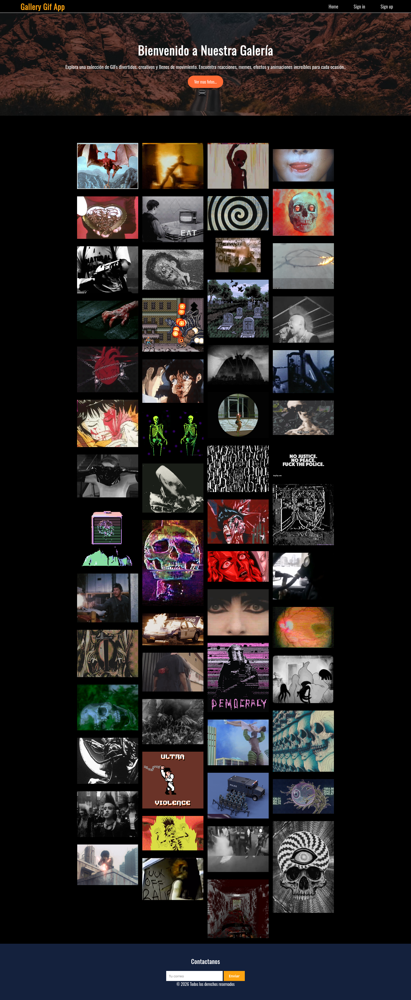
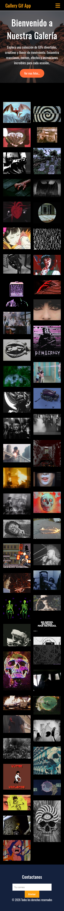

# Gallery Gif App
## Funcionalidades
- Vista de una pagina principal de ina galeria
- Carga de recursos de imagenes Gif
## Tecnologías utilizadas
- **Frontend:** JavaScript, HTML, CSS
- **Conexion con recursos:** Fetch
## Arquitecturas
- Monolitica
> Vista 1 de la pagina  
  
> Vista 2 de la pagina  
  
> Vista 3 de la pagina  
  
# **Nota:** Antes de salir, pasate a ver las branches